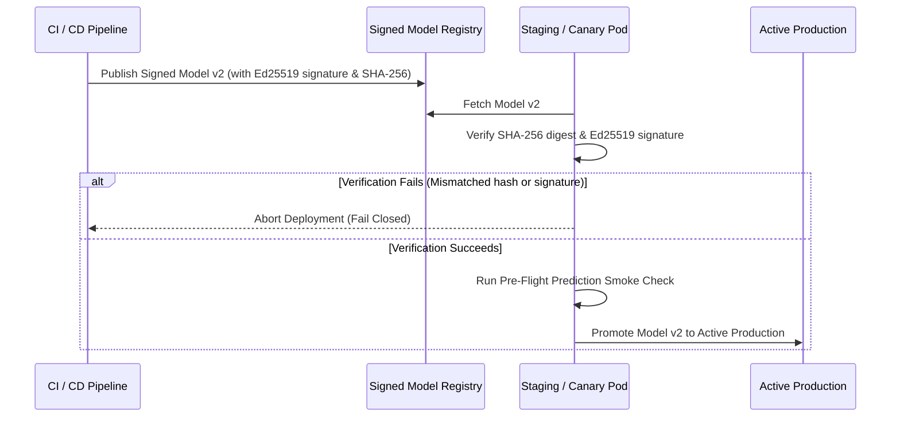

# EveryO Deployment Readiness & Observability Qualification

## 1. Production Architecture & Serving Topology

EveryO inference is designed for cloud-native, edge, and on-premises environments. In production, EveryO employs a **two-tier segmented topology** to isolate raw execution from untrusted networks:

```mermaid
flowchart TD
    Client["Untrusted Clients / API Consumers"] -->|HTTPS / TLS 1.3 (Port 443)| Gateway["Hardened Nginx Reverse Proxy"]
    
    subgraph Sandbox["Hardened Container / Network Sandbox"]
        Gateway -->|TLS Termination & Rate Limiting| RateLimit{"Rate Limit<br/><= 50 r/s"}
        RateLimit -->|Forward to Loopback| AppServer["EveryO CPUModelServer<br/>(127.0.0.1:8000)"]
        
        AppServer --> Runtime["CPUInferenceRuntime"]
        Runtime --> Baseline["NumPy CPU Reference Engine"]
    end
    
    subgraph Observability["Cluster Monitoring & Orchestration"]
        K8s["Kubernetes / Docker Health Monitor"] -.->|GET /healthz| Gateway
        K8s -.->|GET /readyz| Gateway
        Prometheus["Prometheus Scraper"] -.->|GET /metrics| Gateway
    end
```

---

## 2. Gateway Security & Reverse Proxy Directives

The production reverse proxy configuration is maintained in `configs/deployment/nginx.conf`.

### 2.1 Key Operational Directives

1. **Strict Transport Security (TLS 1.2 / 1.3)**:
   - Older protocols (SSLv2, SSLv3, TLS 1.0, TLS 1.1) are explicitly disabled.
   - Forward secrecy ciphers (ECDHE-ECDSA / ECDHE-RSA) are enforced.
2. **Denial-of-Service & Buffer Bounds**:
   - `client_max_body_size 1m`: Drops oversized payloads before they consume application memory.
   - `client_body_timeout 10s` and `keepalive_timeout 65s`: Prevents slowloris attacks.
3. **Adaptive Rate & Connection Limiting**:
   - `limit_req_zone $binary_remote_addr zone=everyo_rate_limit:10m rate=50r/s`: Enforces per-client token bucket limiting with a burst capacity of 20 requests.
   - `limit_conn_zone $binary_remote_addr zone=everyo_conn_limit:10m`: Caps concurrent TCP connections per IP to 10.
4. **Mandatory Security Headers**:
   - `Strict-Transport-Security: max-age=63072000; includeSubDomains; preload`
   - `X-Content-Type-Options: nosniff`
   - `X-Frame-Options: DENY`
   - `Content-Security-Policy: default-src 'none'; frame-ancestors 'none';`

---

## 3. Container Hardening & Non-Root Execution

The production container image specification is defined in `configs/deployment/Dockerfile`.

### 3.1 Sandboxing & Security Controls

- **Multi-Stage Build**:
  - *Builder Stage*: Builds distribution wheels in an isolated builder container.
  - *Runtime Stage*: Copies only the compiled wheel into a minimal `python:3.12-slim-bookworm` base. Compilers and build tools are purged from the final image.
- **Non-Root User (`everyo`)**:
  - Explicit UID/GID `10001:10001`.
  - Process execution drops root privileges permanently.
- **Read-Only Root Filesystem**:
  - The root filesystem is mounted read-only (`read_only: true`).
  - Scratch memory is mounted as an in-memory `tmpfs` with `noexec, nosuid` options (`/tmp:rw,noexec,nosuid,size=64m`).
- **Native Health Probes**:
  - Built-in `HEALTHCHECK` directive executes an internal loopback check against `/health` every 10 seconds.

---

## 4. Orchestration Probes & Observability

EveryO implements standard HTTP endpoints for cloud orchestrators (Kubernetes, Nomad, Docker Swarm):

| Endpoint | Method | Purpose | Response Payload |
|---|---|---|---|
| `/health`, `/healthz` | `GET` | **Liveness Probe**: Confirms server process is responsive and thread loop is alive. | `{"status": "ok", "backend": "cpu"}` |
| `/ready`, `/readyz` | `GET` | **Readiness Probe**: Confirms model parameters are loaded in memory and inference slots are available. | `{"status": "ready", "backend": "cpu"}` |
| `/metrics` | `GET` | **Telemetry Probe**: Aggregate counters for total requests, errors, and accumulated latency. | `{"requests": 1420, "errors": 0, "total_latency_seconds": 3.42}` |
| `/v1/predict` | `POST` | **Inference Endpoint**: Accepts batched JSON tensor inputs, validates authentication, dispatches inference. | `{"outputs": [[0.82, 0.18]], "count": 1}` |

---

## 5. Model Deployment, Backup & Rollback Runbook

Production model updates must execute without service downtime or unverified state transitions.

### 5.1 Deployment Lifecycle



### 5.2 Rollback Runbook

If a newly deployed model exhibits anomalous behavior or post-deployment validation fails:

1. **Automatic Fail-Closed Rollback**:
   The deployment policy immediately rolls back to the last known healthy checkpoint (`model_v1.0.0.evo`) if artifact validation fails during startup.
2. **Manual Rollback Command**:
   ```bash
   # 1. Verify last known healthy artifact digest
   everyo doctor --check-model /app/models/backup_checkpoint.evo

   # 2. Re-point active model symlink
   ln -sfn /app/models/backup_checkpoint.evo /app/models/active_model.evo

   # 3. Reload worker runtime (zero-downtime reload)
   kill -HUP $(pgrep -f "everyo-cpu-http")
   ```
3. **Post-Rollback Verification**:
   Verify readiness endpoint:
   ```bash
   curl -s -f http://127.0.0.1:8000/readyz || exit 1
   ```

---

## 6. Automated Deployment Qualification Tests

Automated regression tests are implemented in `tests/test_production_deployment_qualification.py`:
- `TestHealthAndObservabilityEndpoints`: Validates `/health`, `/healthz`, `/ready`, `/readyz`, `/metrics`, and headers.
- `TestDeploymentConfigurations`: Verifies Nginx and Dockerfile security directives.
- `TestBackupAndRollbackProcedures`: Verifies fail-closed rollback upon artifact corruption.
