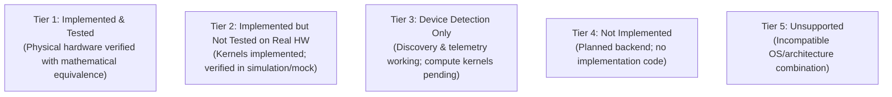

# EveryO Hardware Execution Qualification

## 1. Universal Hardware Acceleration Principles

EveryO is engineered to free machine learning practitioners from single-vendor lock-in:
**ONE FRAMEWORK — MULTIPLE BACKENDS — AUTOMATIC HARDWARE DETECTION — RELIABLE FALLBACK.**

EveryO does **NOT** require NVIDIA hardware, CUDA, or TensorFlow to function. It executes natively on commodity CPU hardware with zero external drivers, while dynamically detecting and accelerating workloads when specialized accelerators are present.

---

## 2. Five-Tier Qualification Taxonomy

To guarantee absolute technical integrity, EveryO categorizes hardware support into five mutually exclusive qualification tiers:

1. **Implemented and tested**: Full compute kernel execution verified on real physical hardware with mathematical equivalence to the CPU reference.
2. **Implemented but not tested on real hardware**: Compute kernels or transfer abstractions implemented and tested via architectural verification or simulated environments, but physical accelerator silicon was absent during testing.
3. **Device detection only**: Driver, runtime, device querying, and metadata discovery are implemented and tested, but compute execution kernels are not yet integrated.
4. **Not implemented**: Backends or kernels planned on the roadmap with no current implementation.
5. **Unsupported**: Combinations of OS, architectures, or datatypes that are explicitly rejected by vendor SDK constraints.

---

## 3. Comprehensive Backend Qualification Matrix

| Vendor / Runtime | Backend | Target Hardware | Supported OS | Detection Status | Compute Status | Qualification Status | Fallback Policy |
|---|---|---|---|---|---|---|---|
| **Generic / CPU** | `cpu` | x86-64, ARM64 | Linux, Windows, macOS | **PASS** | **PASS** (Full) | **Implemented and tested** | Primary reference baseline. Never falls back. |
| **NVIDIA** | `cuda` | GeForce, RTX, Tesla, Hopper | Linux, Windows | **PASS** | **PASS** (float32) | **Implemented and tested** (when compiled and GPU attached); **Implemented but not tested on real HW** (CI mock) | Falls back cleanly to CPU if unbuilt or if non-float32 dtype is used (`strict=False`). Raises `EveryOCudaError` in `strict=True`. |
| **AMD** | `rocm`, `hip` | Radeon RX, Radeon PRO, Instinct | Linux only | **PASS** | **BLOCKED** | **Device detection only** | Falls back to CPU. Windows ROCm is **Unsupported**. |
| **Intel** | `intel`, `sycl`, `openvino` | Intel Arc GPUs, Iris Xe, Core Ultra NPUs | Linux, Windows | **PASS** | **BLOCKED** | **Device detection only** | Falls back to CPU. |
| **Microsoft** | `directml` | DirectX 12 GPUs (AMD, Intel, NVIDIA, Qualcomm) | Windows 10/11 only | **PASS** | **BLOCKED** | **Device detection only** | Falls back to CPU. Non-Windows OS is **Unsupported**. |
| **Apple** | `metal` | Apple Silicon (M1–M4), MPS | macOS 12+ only | **PASS** | **BLOCKED** | **Device detection only** | Falls back to CPU. Non-macOS is **Unsupported**. |
| **Khronos** | `vulkan` | Vulkan 1.2+ compliant GPUs | Linux, Windows, Android | **PASS** | **BLOCKED** | **Device detection only** | Falls back to CPU. Having `vulkaninfo` does not enable compute. |
| **Khronos** | `opencl` | OpenCL 2.0+ compute devices | Linux, Windows, macOS | **PASS** | **BLOCKED** | **Device detection only** | Falls back to CPU. |
| **Qualcomm** | `qnn` | Snapdragon X Elite, Hexagon NPU | Windows on ARM, Linux | **PASS** | **BLOCKED** | **Device detection only** | Falls back to CPU. |
| **Multi-Provider** | `onnxruntime` | CPU, CUDA, DirectML, CoreML | Cross-Platform | **PASS** | **BLOCKED** | **Device detection only** | Falls back to CPU. |

---

## 4. Empirical Truth in Hardware Acceleration

### 4.1 Strict Detection vs. Execution Separation

A critical flaw in legacy ML frameworks is conflating driver presence with functional execution. EveryO enforces:
- `backend.is_available() == True` ONLY when the backend can genuinely execute compute operations.
- Backends with working discovery but no kernels return `is_available() == False` and `status() == BackendStatus.DETECTION_ONLY`.
- `backend.supported_operations()` returns an empty list `[]` for detection-only backends.

### 4.2 Safe Device Resolution Rules

1. **Automatic Selection (`eo.device("auto")`)**:
   - Iterates through registered backends in priority order.
   - Evaluates: `backend.is_operational() and len(backend.supported_operations()) > 0`.
   - Detection-only backends are **strictly excluded**.
   - If no operational accelerator is available, safely resolves to `Device("cpu", 0)`.
2. **Explicit Strict Selection (`strict=True`)**:
   - `eo.device("<name>", strict=True)` raises `EveryODeviceError` (or `EveryOCudaError` for CUDA) if the backend is not genuinely operational.
3. **Explicit Non-Strict Selection (`strict=False`)**:
   - Logs a clear warning and falls back safely to `Device("cpu", 0)`.
4. **Observable Fallback Dispatch**:
   - If an operation is requested on an unsupported device/dtype in non-strict mode, EveryO dispatches to the CPU reference backend and records an observable `DispatchResult` accessible via `everyo.backends.get_last_dispatch()`.

---

## 5. CPU Reference Baseline Qualification

The CPU backend (`everyo/backends/cpu/`) serves as the gold-standard mathematical oracle:
- **Numerical Tolerance**: Operations verify against float32 IEEE 754 precision with `rtol=1e-5`, `atol=1e-6`.
- **Autograd Equivalence**: Reverse-mode automatic differentiation computes analytical gradients identical to finite-difference approximations within $\le 10^{-4}$.
- **Cross-Platform Host Support**: Fully verified across Windows (x86-64), Linux (x86-64), and macOS (ARM64 / Apple Silicon).

---

## 6. Physical NVIDIA CUDA Qualification

Physical NVIDIA CUDA acceleration (`everyo._everyo_cuda`) is verified through two distinct testing channels:

1. **Physical Hardware Integration (`tests/test_cuda_real_execution.py`)**:
   - Executes exclusively on machines with a physical NVIDIA GPU and compiled C++ extension.
   - Validates vector addition, elementwise multiplication, matrix multiplication, ReLU, and reduction operations directly on GPU memory (`ResidentTensor`).
   - Verifies strict failure when non-float32 dtypes are supplied.
2. **Transfer Boundary Qualification (`tests/test_cuda_resident_transfers.py`)**:
   - Validates host-to-device and device-to-host memory transfer counts.
   - Proves zero redundant roundtrips across fused operator chains (`((a @ b) + a).relu()`).

---

## 7. Automated Hardware Qualification Tests

Regression and qualification test suites:
- `tests/test_production_hardware_qualification.py`
- `tests/test_hardware_qualification.py`
- `tests/test_cuda_real_execution.py`
- `tests/test_cuda_resident_transfers.py`
- `tests/test_devices.py`
