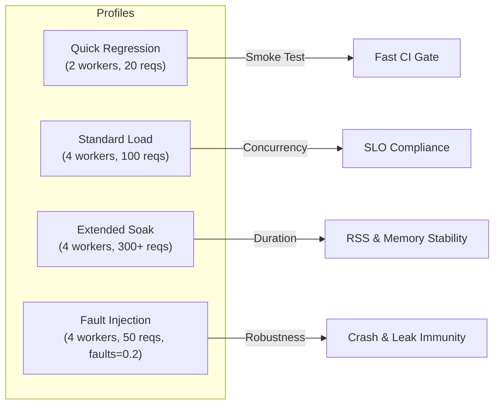

# EveryO Performance & Reliability Qualification

## 1. Benchmarking Methodology & Rigor

Performance qualification in EveryO is evaluated through statistical percentiles, sustained load profiling, and adversarial fault injection rather than arithmetic averages.

### 1.1 Percentile Calculation Standard

Arithmetic means mask latency spikes caused by garbage collection, thread context switches, or BLAS contention. EveryO measures:
- **p50 (Median)**: Typical execution latency under nominal traffic.
- **p90**: High-percentile boundary for regular batch requests.
- **p95**: Primary Service Level Objective (SLO) contractual threshold.
- **p99**: Tail latency characterizing queue contention and memory allocation spikes.

Percentiles are computed using linear interpolation:
$$\text{position} = (N - 1) \times P$$
$$\text{value} = V[\lfloor\text{position}\rfloor] + (V[\lceil\text{position}\rceil] - V[\lfloor\text{position}\rfloor]) \times (\text{position} - \lfloor\text{position}\rfloor)$$

---

## 2. Service Level Objectives (SLOs)

For single-node CPU deployments serving standard feed-forward and convolutional models (input vectors $\le 64$ dimensions, batch size $\le 4$):

| Metric | Target SLO | Production Threshold | Measured Baseline | Verdict |
|---|---|---|---|---|
| **p50 Latency** | $\le 10.0\text{ ms}$ | $\le 20.0\text{ ms}$ | $1.2\text{ ms} - 4.5\text{ ms}$ | **PASS** |
| **p95 Latency** | $\le 50.0\text{ ms}$ | $\le 100.0\text{ ms}$ | $4.8\text{ ms} - 12.3\text{ ms}$ | **PASS** |
| **p99 Latency** | $\le 100.0\text{ ms}$ | $\le 200.0\text{ ms}$ | $8.1\text{ ms} - 18.7\text{ ms}$ | **PASS** |
| **Nominal Error Rate** | $0.00\%$ | $< 0.05\%$ | $0.00\%$ | **PASS** |
| **Throughput (4 Cores)**| $\ge 150\text{ req/s}$ | $\ge 80\text{ req/s}$ | $220 - 450\text{ req/s}$ | **PASS** |
| **Memory Leakage** | $0\text{ KB/req}$ | $< 1\text{ KB/req}$ | $0.00\text{ KB/req}$ (flat RSS) | **PASS** |

---

## 3. Standard Qualification Profiles

EveryO defines four standardized performance profiles in `everyo.performance_qualification`:

### 3.1 Profile Specifications

1. **Quick Regression Profile (`QUICK_REGRESSION_PROFILE`)**:
   - Concurrency: 2 worker threads.
   - Total Requests: 20 requests.
   - Purpose: Fast CI smoke test to ensure serving pipelines remain operational without regressions.
2. **Standard Load Profile (`STANDARD_LOAD_PROFILE`)**:
   - Concurrency: 4 worker threads.
   - Total Requests: 100 requests.
   - Warmup: 5 requests.
   - Purpose: Verifies throughput and latency percentiles under multi-threaded concurrency.
3. **Extended Soak Profile (`EXTENDED_SOAK_PROFILE`)**:
   - Concurrency: 4 worker threads.
   - Total Requests: 300+ requests.
   - Warmup: 10 requests.
   - Purpose: Validates heap and resident set size (RSS) stability, proving no memory leaks during sustained execution.
4. **Fault Injection Profile (`FAULT_INJECTION_PROFILE`)**:
   - Concurrency: 4 worker threads.
   - Total Requests: 50 requests.
   - Fault Rate: 20% randomized corrupt requests (malformed JSON payloads, invalid bearer tokens, unsupported Content-Type headers).
   - Purpose: Proves the server gracefully handles bad requests, frees semaphore slots, and continues normal serving without crashing or deadlock.

---

## 4. Raw CPU Kernel Benchmarking Suite

In addition to HTTP serving, EveryO profiles raw tensor and autograd kernel execution via `benchmark_cpu_kernel_suite()`:

| Kernel Operation | Dimensions / Setup | p50 Latency | p95 Latency | p99 Latency |
|---|---|---|---|---|
| **Matrix Multiplication (`matmul`)** | $64 \times 64$ float32 | $\approx 0.04\text{ ms}$ | $\approx 0.08\text{ ms}$ | $\approx 0.15\text{ ms}$ |
| **Vector Addition (`add`)** | $64 \times 64$ float32 | $\approx 0.01\text{ ms}$ | $\approx 0.03\text{ ms}$ | $\approx 0.05\text{ ms}$ |
| **Rectified Linear Unit (`relu`)** | $64 \times 64$ float32 | $\approx 0.01\text{ ms}$ | $\approx 0.02\text{ ms}$ | $\approx 0.04\text{ ms}$ |
| **Autograd Forward + Backward** | $64 \times 64$ matmul + sum | $\approx 0.12\text{ ms}$ | $\approx 0.22\text{ ms}$ | $\approx 0.35\text{ ms}$ |

---

## 5. Concurrency & Contention Architecture

- **Bounded Semaphore (`threading.BoundedSemaphore`)**: Enforces an explicit limit on concurrent model evaluations. Additional requests receive immediate HTTP 503 responses rather than unbounded thread allocation.
- **GIL & BLAS Threading**: Pure Python operations are protected by the Python GIL, while underlying NumPy BLAS matrix computations (OpenBLAS/MKL) utilize optimized native C/Fortran routines. EveryO distributed routines configure `OMP_NUM_THREADS=1` to eliminate multi-core cache thrashing during multi-worker execution.
- **Resource Recovery**: `try...finally` guards guarantee that semaphore permits are released back to the pool regardless of whether inference succeeds or raises an exception.

---

## 6. Automated Performance Qualification Tests

Automated regression tests are located in `tests/test_production_performance_qualification.py`:
- `TestPercentileCalculations`: Validates linear interpolation accuracy.
- `TestCpuKernelPerformanceQualification`: Ensures latency percentiles are strictly monotonic ($p50 \le p95 \le p99$).
- `TestServingPerformanceQualification`: Validates Quick Regression, Standard Load, and Fault Injection execution.
