# EveryO Phase 21: Production Qualification and Hardware Execution

## 1. Executive Statement & Scope

EveryO version **v0.5.0** is an open-source, multi-hardware machine learning and numerical computing framework designed to provide CPU-first neural execution with transparent hardware acceleration across heterogeneous vendors.

Phase 21 establishes a formal, auditable **Engineering Qualification Programme** across four core disciplines:
1. **Security & Supply Chain**: Vulnerability elimination, static analysis (CodeQL), cryptographic provenance (Ed25519), deserialization hardening, and standardized Software Bill of Materials (SBOM; CycloneDX v1.5 and SPDX v2.3).
2. **Performance & Reliability**: Rigorous latency percentiles (p50, p90, p95, p99), throughput profiling (requests/sec), concurrency scaling, extended soak evaluation, and fault injection resilience.
3. **Deployment Readiness & Observability**: Production serving topologies, TLS 1.2/1.3 reverse-proxy hardening, containerized non-root sandboxing, standard orchestration probes (`/healthz`, `/readyz`), telemetry metrics (`/metrics`), and fail-closed rollback procedures.
4. **Real Hardware Execution**: Empirical verification of the CPU reference baseline, strict gating and qualification of physical NVIDIA CUDA acceleration, and operational gating of non-CUDA multi-vendor backends (AMD ROCm, Intel SYCL, Microsoft DirectML, Apple Metal, Khronos Vulkan/OpenCL, Qualcomm QNN).

> [!IMPORTANT]
> EveryO explicitly rejects cosmetic "production ready" claims. A passing automated unit test suite does not constitute production qualification. Each subsystem is evaluated against empirical evidence, operational boundaries, and fail-closed governance.

---

## 2. Core Engineering Principles

1. **Empirical Truth in Hardware Support**: Hardware detection (querying a device node, driver version, or CLI binary) is **never** conflated with operational compute execution. Backends lacking compute kernels remain strictly marked `DETECTION_ONLY` and are prohibited from accepting compute workloads without safe CPU fallback.
2. **Zero Mandatory Vendor Lock-in**: EveryO functions out-of-the-box on standard commodity x86-64 and ARM64 CPUs with pure NumPy. Specialized accelerator toolchains (CUDA, ROCm, oneAPI, DirectML) are optional plugins.
3. **Fail-Closed Security Gating**: Any unverified model artifact, mismatched SHA-256 digest, broken Ed25519 signature, path traversal attempt, or unauthorized staging request fails immediately with explicit exceptions, preventing silent state corruption.
4. **Observable Operator Dispatch**: Hardware fallback from accelerators to the CPU reference backend is never silent; fallback decisions, reasons, and target backends are logged and queryable via `get_last_dispatch()`.

---

## 3. Qualification Baseline

- **Repository**: [EveryO (GitHub)](https://github.com/krishanth7/EveryO)
- **Baseline Commit**: `ee0430da199777d071b00466086c3fcecebd6a4e`
- **Framework Version**: `0.5.0` (immutable release version)
- **Host Operating Systems Tested**: Windows 11 (x86-64), Linux Ubuntu 24.04 (x86-64), macOS 14+ / Darwin (ARM64 / Apple Silicon).
- **Python Compatibility**: Python 3.9, 3.10, 3.11, 3.12 (with forward compatibility validation on 3.15 preview).

---

## 4. Phase 21 Qualification Domains

```mermaid
graph TD
    P21["Phase 21 Production Qualification"] --> SEC["Domain 1: Security & Supply Chain"]
    P21 --> PERF["Domain 2: Performance & Reliability"]
    P21 --> DEP["Domain 3: Deployment Readiness"]
    P21 --> HW["Domain 4: Hardware Execution"]

    SEC --> SEC1["CodeQL Static Analysis"]
    SEC --> SEC2["CycloneDX & SPDX SBOM"]
    SEC --> SEC3["Ed25519 Artifact Signing"]
    SEC --> SEC4["Deserialization Hardening"]

    PERF --> PERF1["p50 / p95 / p99 Percentiles"]
    PERF --> PERF2["Concurrency & Throughput"]
    PERF --> PERF3["Extended Soak Profiling"]
    PERF --> PERF4["Fault Injection Resilience"]

    DEP --> DEP1["TLS 1.3 / Nginx Reverse Proxy"]
    DEP --> DEP2["Non-Root Containerization (UID 10001)"]
    DEP --> DEP3["/healthz & /readyz Probes"]
    DEP --> DEP4["Fail-Closed Rollback Procedures"]

    HW --> HW1["CPU Reference Baseline (PASS)"]
    HW --> HW2["NVIDIA CUDA Kernel Execution (PASS/Gated)"]
    HW --> HW3["Non-CUDA Discovery & Gating (PASS)"]
    HW --> HW4["Non-CUDA Compute Kernels (BLOCKED/Pending)"]
```

---

## 5. Qualification Decision Matrix

| Subsystem / Discipline | Evaluated Scope | Status | Primary Reference / Evidence |
|---|---|---|---|
| **Security: Deserialization** | Zip bomb limits, directory traversal rejection, `allow_pickle=False` | **PASS** | [SECURITY_QUALIFICATION.md](file:///D:/EveryO/docs/production/SECURITY_QUALIFICATION.md) |
| **Security: Provenance** | Ed25519 detached signatures, SHA-256 digest validation | **PASS** | [SECURITY_QUALIFICATION.md](file:///D:/EveryO/docs/production/SECURITY_QUALIFICATION.md) |
| **Security: Supply Chain** | CycloneDX 1.5 & SPDX 2.3 SBOM generation, automated scanning | **PASS** | [SECURITY_QUALIFICATION.md](file:///D:/EveryO/docs/production/SECURITY_QUALIFICATION.md) |
| **Performance: Latency** | p50 < 10ms, p95 < 50ms, p99 < 100ms on local CPU inference | **PASS** | [PERFORMANCE_QUALIFICATION.md](file:///D:/EveryO/docs/production/PERFORMANCE_QUALIFICATION.md) |
| **Performance: Soak** | Sustained execution over 300+ cycles without memory leakage | **PASS** | [PERFORMANCE_QUALIFICATION.md](file:///D:/EveryO/docs/production/PERFORMANCE_QUALIFICATION.md) |
| **Performance: Faults** | Injected malformed payloads, invalid tokens, 400/401/415 handling | **PASS** | [PERFORMANCE_QUALIFICATION.md](file:///D:/EveryO/docs/production/PERFORMANCE_QUALIFICATION.md) |
| **Deployment: Gateway** | Nginx reverse proxy with TLS 1.3, rate limiting, security headers | **PASS** | [DEPLOYMENT_QUALIFICATION.md](file:///D:/EveryO/docs/production/DEPLOYMENT_QUALIFICATION.md) |
| **Deployment: Container** | Non-root `everyo:10001`, read-only rootfs, internal health check | **PASS** | [DEPLOYMENT_QUALIFICATION.md](file:///D:/EveryO/docs/production/DEPLOYMENT_QUALIFICATION.md) |
| **Deployment: Recovery** | Automatic fallback to backup model upon candidate validation failure | **PASS** | [DEPLOYMENT_QUALIFICATION.md](file:///D:/EveryO/docs/production/DEPLOYMENT_QUALIFICATION.md) |
| **Hardware: CPU Baseline** | Math, LinAlg, Reductions, Activations, Autograd, Optimizers | **PASS** | [HARDWARE_EXECUTION_QUALIFICATION.md](file:///D:/EveryO/docs/production/HARDWARE_EXECUTION_QUALIFICATION.md) |
| **Hardware: NVIDIA CUDA** | Real hardware kernel execution when compiled & GPU attached; clean gating when absent | **PASS / GATED** | [HARDWARE_EXECUTION_QUALIFICATION.md](file:///D:/EveryO/docs/production/HARDWARE_EXECUTION_QUALIFICATION.md) |
| **Hardware: AMD ROCm/HIP** | Linux hardware detection & topology querying | **PASS** (Detection) | [HARDWARE_EXECUTION_QUALIFICATION.md](file:///D:/EveryO/docs/production/HARDWARE_EXECUTION_QUALIFICATION.md) |
| **Hardware: AMD Compute** | Native HIP compute kernels | **BLOCKED** | Phase 22 Development Roadmap |
| **Hardware: Intel oneAPI** | Linux/Windows detection via `sycl-ls` / OpenVINO runtime | **PASS** (Detection) | [HARDWARE_EXECUTION_QUALIFICATION.md](file:///D:/EveryO/docs/production/HARDWARE_EXECUTION_QUALIFICATION.md) |
| **Hardware: Intel Compute** | Native SYCL compute kernels | **BLOCKED** | Phase 22 Development Roadmap |
| **Hardware: DirectML** | Windows DirectX 12 adapter detection | **PASS** (Detection) | [HARDWARE_EXECUTION_QUALIFICATION.md](file:///D:/EveryO/docs/production/HARDWARE_EXECUTION_QUALIFICATION.md) |
| **Hardware: Apple Metal** | macOS Apple Silicon device detection | **PASS** (Detection) | [HARDWARE_EXECUTION_QUALIFICATION.md](file:///D:/EveryO/docs/production/HARDWARE_EXECUTION_QUALIFICATION.md) |
| **Hardware: Vulkan / OpenCL** | Cross-platform ICD driver detection | **PASS** (Detection) | [HARDWARE_EXECUTION_QUALIFICATION.md](file:///D:/EveryO/docs/production/HARDWARE_EXECUTION_QUALIFICATION.md) |
| **Hardware: Qualcomm QNN** | Snapdragon NPU discovery | **PASS** (Detection) | [HARDWARE_EXECUTION_QUALIFICATION.md](file:///D:/EveryO/docs/production/HARDWARE_EXECUTION_QUALIFICATION.md) |

---

## 6. Document Roadmap

Detailed specifications and verifiable evidence registers are maintained in the following dedicated production qualification records:
- [SECURITY_QUALIFICATION.md](file:///D:/EveryO/docs/production/SECURITY_QUALIFICATION.md): Threat models, supply chain SBOM, cryptographic controls, and penetration defenses.
- [PERFORMANCE_QUALIFICATION.md](file:///D:/EveryO/docs/production/PERFORMANCE_QUALIFICATION.md): Benchmarking methodology, percentile latencies, soak tests, and fault resilience.
- [DEPLOYMENT_QUALIFICATION.md](file:///D:/EveryO/docs/production/DEPLOYMENT_QUALIFICATION.md): Network topology, TLS configuration, container isolation, and rollback runbooks.
- [HARDWARE_EXECUTION_QUALIFICATION.md](file:///D:/EveryO/docs/production/HARDWARE_EXECUTION_QUALIFICATION.md): Multi-vendor acceleration qualification matrix, CPU baseline, and dispatch safety.
- [EVIDENCE_REGISTER.md](file:///D:/EveryO/docs/production/EVIDENCE_REGISTER.md): Structured log of empirical test execution, SHAs, environments, and verdicts.
- [DEFECT_REGISTER.md](file:///D:/EveryO/docs/production/DEFECT_REGISTER.md): Tracked engineering defects, severity classifications, and remediation records.
